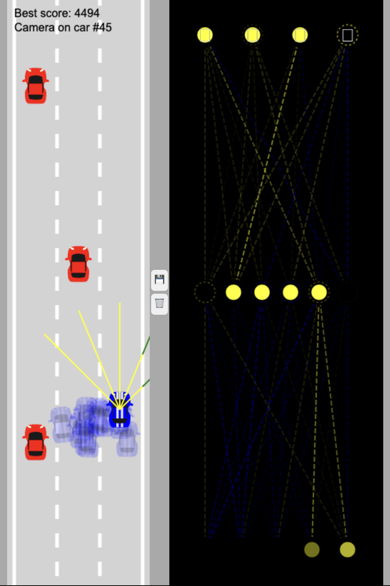

# Self-Driving Car

A little self-driving car sim I built in plain JavaScript. No libraries, no React, nothing, just the browser and a canvas. The cars teach themselves to drive through traffic using a neural network, and I train them with a genetic algorithm.

Live demo: https://umangrazsingh.github.io/SELF_DRIVING_CAR/



### How it actually works

Every car shoots out 5 rays (sensors) that measure the distance to the road edges and nearby cars. Those 5 numbers go into a tiny neural network, basically the car's brain, and it spits out whether to turn left, right, speed up, or reverse. Nobody tells the car how to drive. It just has a brain and has to figure it out.

Training is the fun part. I run 100 cars at the same time, each with a slightly different brain. Whichever one gets the farthest without crashing is the "best" one. I hit save, refresh, and now all 100 cars start from that best brain, except 99 of them get mutated a little. Do that enough times and they slowly stop crashing into everything.

That's the genetic algorithm. Survival of the fittest, but for cars.

### Stuff I added on top of the tutorial

I started this from Radu Mariescu-Istodor's course, but I didn't want it to just be a copy, so I added my own things:

- my own **fitness function** that scores cars by how far they got and subtracts points for crashing, so the winner is whoever drives farthest and survives
- **random endless traffic** instead of a hardcoded list of cars. it just keeps generating traffic forever as you drive
- a spacing bug I had to hunt down. Since my AI cars move faster than the traffic, the traffic kept bunching up into a solid wall after a while and nothing could get through. turned out the spawn logic didn't account for the speed difference. fixed it by spawning each row based on where the actual furthest car is. this one took me a bit
- on-screen info showing current score, which car the camera's watching, and a little "car changed" flash when the leader crashes
- drew my own car shape with curves, headlights and windows instead of plain rectangles

### Running it

It's just HTML and JS, no build step.

```
git clone https://github.com/umangrazsingh/SELF_DRIVING_CAR.git
```

Open `index.html` in a browser, or run it with Live Server in VS Code.

The 💾 button saves the best brain, 🗑️ wipes it. To train: watch it, save when a car does well, refresh, repeat.

### What I got out of it

Building a neural network and a genetic algorithm from scratch (instead of importing a library) made me actually understand what's going on inside them. Also got way more comfortable with canvas drawing, the collision/intersection math, and debugging weird simulation behavior that isn't an obvious error. The traffic bug didn't throw anything, it just *looked* wrong, and I had to reason out why.

---

Umang Raz Singh · [LinkedIn](https://www.linkedin.com/in/umang-raz-singh) · [GitHub](https://github.com/umangrazsingh)
